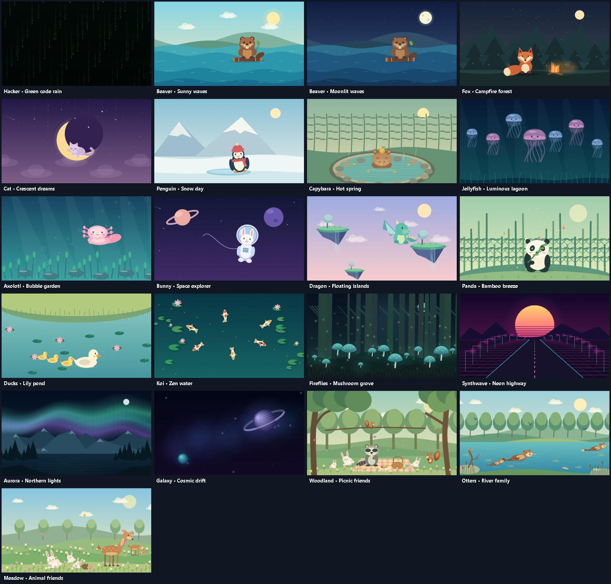

# Live Desktop

An offline Windows live wallpaper app for one, two, or more displays.

[Download the Windows installer](https://github.com/DWAA1660/live-desktop/releases/latest) · [Source code](https://github.com/DWAA1660/live-desktop)



## Install and start automatically

Run **LiveDesktop-Setup-1.1.0.exe**. The installer includes the .NET runtime and installs for your Windows account without administrator access. **Start automatically when I sign in** is selected by default. At sign-in, the app applies your saved wallpapers and runs in the system tray. It waits for Explorer to become ready and retries for up to a minute.

Change this later with **Start with Windows** in the app, or in Windows Startup Apps. Uninstall from Windows Installed Apps or the Start menu to remove the app, shortcuts and startup registration. Your scene preferences remain in `%LOCALAPPDATA%\LiveDesktop`.

## Monitor detection

The app detects all active displays reported by Windows, with no hardcoded two-monitor limit. Each gets its own scrollable preview, scene choice and wallpaper window. Connecting, disconnecting, rearranging or changing the resolution of monitors rebuilds the display list automatically. Brief display-change bursts are combined into one refresh; scene choices and pause state are retained. Monitors to the left or above the primary display are supported. Mirrored displays follow the logical displays reported by Windows.

Random rotation uses different scenes where possible. If you have more monitors than scenes in your selected pool, scenes can be shared; each monitor still avoids immediately repeating its own scene. Processing usage grows with the number and resolution of monitors, so use 15 fps on large setups.

## Run

Open `LiveDesktop.exe` in the `app` folder. Choose a scene for each display and click **Apply wallpapers**. Each monitor can use a different scene.

- **Hacker:** green code cascades over a dark background.
- **Sunny waves:** a cute beaver floats on a driftwood raft, bobbing over layered waves, with blinking eyes and a waving leaf.
- **Moonlit waves:** the same beaver under a moon and twinkling stars.

The collection also includes these animated scenes:

1. Fox — Campfire forest
2. Cat — Crescent dreams
3. Penguin — Snow day
4. Capybara — Hot spring
5. Jellyfish — Luminous lagoon
6. Axolotl — Bubble garden
7. Bunny — Space explorer
8. Dragon — Floating islands
9. Panda — Bamboo breeze
10. Ducks — Lily pond
11. Koi — Zen water
12. Fireflies — Mushroom grove
13. Synthwave — Neon highway
14. Aurora — Northern lights
15. Galaxy — Cosmic drift
16. Woodland — Picnic friends (raccoons, rabbits, squirrels and drifting butterflies)
17. Otters — River family (swimming and diving otters, birds and fish)
18. Meadow — Animal friends (rabbits, hedgehogs and grazing deer)

The duck family now follows a continuous swimming route with delayed duckling paths, head movements, wing movements and water ripples. The panda breathes and chews among drifting butterflies. The three new habitats have multiple animals with separate movement and behavior cycles.

Water highlights are drawn behind the beaver and its raft in both beaver scenes.

Adjust motion speed and choose 15, 30, or 60 fps. 30 fps is the default; 15 fps uses less processing time.

## Rotation

**Rotate backgrounds** changes the scenes automatically while the app runs, including while the controls are hidden in the tray. The default is **Random**, **Cute + calm**, every **30 minutes**. Choose 15 minutes, 30 minutes, 1 hour, 2 hours or 4 hours. The pools are **Cute animals**, **Cute + calm**, or **All backgrounds**. **In order** cycles through the selected pool instead of shuffling.

Random changes avoid the scenes currently showing and choose different scenes for the monitors. **Next background** switches immediately; it is also available in the tray menu. Scene changes reuse the existing desktop windows, so Explorer does not need to be detached or restarted. Pausing also freezes the rotation countdown. Uncheck **Rotate backgrounds** to keep manual selections. Rotation preferences are saved locally.

**Pause / Resume** freezes or restarts the animation. **Restore desktop** removes the animated windows and reveals your existing wallpaper. Closing the controls keeps the app running in the system tray. Right-click the tray icon to reopen controls, pause, restore, or **Exit**. Exit also restores the desktop.

Theme and performance choices are saved locally in `%LOCALAPPDATA%\LiveDesktop\settings.json`. The installed Start menu shortcut applies them immediately; a portable launch without arguments opens preview mode. **Refresh displays** also provides a manual refresh.

## Compatibility

Built for Windows 10/11 x64 with the standard Explorer desktop. No administrator access, account, internet connection, or subscription is needed to run. The portable app includes its .NET runtime. Scenes render locally with GDI+ and use Direct3D 11 to present frames on modern Windows 11 desktops. The Explorer wallpaper layer is an undocumented integration and can change with Windows updates. If attachment fails, the app shows an error and closes its wallpaper windows. Restart Explorer and try again. It does not cover the lock screen.

## Source / build

With .NET SDK 8 installed:

```powershell
./scripts/build.ps1
./scripts/test.ps1
# Build the installer too (requires Inno Setup 6):
./scripts/build.ps1 -Installer
# Check native attachment on this computer's real monitors:
./scripts/test.ps1 -Desktop
```

Build output goes to `artifacts/app`, with the installer under `artifacts/installer`. GitHub Actions builds and runs the rendering and monitor-logic checks on Windows.

`LiveDesktop.exe --render-test` renders all 21 preview PNGs and a collection contact sheet, verifies that each scene changes with time, checks rotation and simulated monitor layouts with 1, 2, 3, 8 and 32 displays, tests monitor removal, and checks that wave highlights never overlap the beaver's opaque foreground. `--self-test` additionally tests desktop attachment, Direct3D presentation and switching scenes on each detected display. Results are written to `test-results` beside the executable. `--apply` opens the controls and applies saved scenes; `--startup` applies them after Explorer initializes and hides the controls in the tray.

The application source is licensed under MIT. Bundled .NET runtime files remain subject to Microsoft's runtime licenses.

Windows API references: [SetParent](https://learn.microsoft.com/en-us/windows/win32/api/winuser/nf-winuser-setparent) and [multiple-monitor coordinates](https://learn.microsoft.com/en-us/windows/win32/gdi/multiple-monitor-system-metrics).
